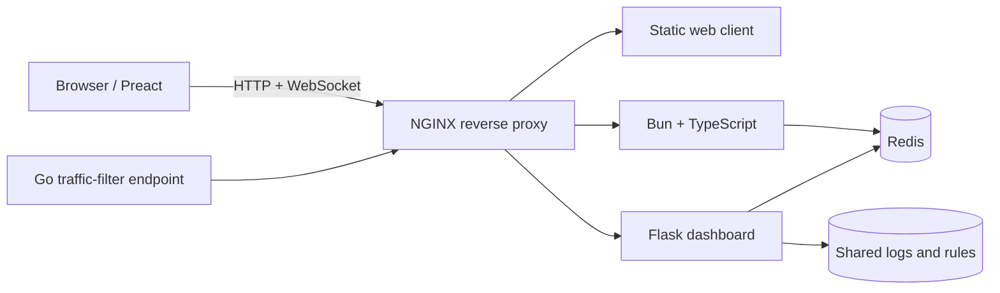

# DockerChat

**Open two browser windows. Start a conversation. Explore the network behind it.**

DockerChat is a self-hosted chat and network-security lab: a Preact interface, a Bun WebSocket backend, Redis storage, an NGINX reverse proxy, a Go traffic filter, and a Flask operations dashboard, brought together with Docker Compose.

[](LICENSE)
[](https://github.com/Nick-Maro/DockerChat/actions/workflows/ci.yml)

[Get started](#get-started) · [How it fits together](#how-it-fits-together) · [Contribute](CONTRIBUTING.md) · [Security model](SECURITY.md)

## Why try it?

- **A complete playground, not just a chat screen.** Follow messages from the browser through a reverse proxy and a WebSocket service into Redis.
- **Rooms and private conversations.** Public rooms, direct messages, file attachments, message history, unread indicators, and reconnect handling.
- **Browser-side cryptography to inspect and improve.** Direct-message text and attachments use P-256 ECDH and AES-GCM; commands are signed with RSA/SHA-256, including their payloads.
- **Operations you can see.** Inspect connection statistics, logs, Redis data, users, and traffic-filter rules from a separate dashboard.
- **A useful learning codebase.** TypeScript, Go, Python, Docker, and NGINX meet in one small system with regression tests for authentication and the dashboard.

This is an **educational project under active development**. Public room messages are plaintext to the server. The server distributes peer keys, metadata remains visible, and the protocol has not been independently audited. Use test conversations, and read the [security model](SECURITY.md) before exposing it beyond your computer.

## Get started

You need Docker with the Compose v2 plugin and Python 3.10+ for the configuration helper. Docker Desktop works on Windows/macOS; Linux needs Docker Engine and Compose. Node, Bun, and Go are only needed when developing outside containers.

```sh
git clone https://github.com/Nick-Maro/DockerChat.git
cd DockerChat
python tools/setup_env.py
docker compose config --quiet
docker compose up --build -d
```

The helper creates a private `.env` with a fresh dashboard password, Redis password, and Flask signing key. It refuses to overwrite an existing configuration. On systems where Python is named `python3`, use that command instead.

| Open | Purpose |
| --- | --- |
| <http://client.localhost> | Chat interface |
| <http://dashboard.localhost> | Operations dashboard |
| <http://api.localhost/status> | Backend status |

The dashboard username is `admin`; find its generated password in `.env` under `ADMIN_PASSWORD`. Open a second browser profile or an incognito window to register another chat identity. Different tabs in the same browser profile share stored keys and identity.

The published ports bind to **127.0.0.1 by default**. Port 80 and 443 must be free. If your system does not resolve the local hostnames, add this entry to your hosts file:

```text
127.0.0.1 client.localhost dashboard.localhost api.localhost
```

Hosts file locations: `/etc/hosts` on Linux/macOS, or `C:\Windows\System32\drivers\etc\hosts` on Windows. Editing this file may need administrator privileges.

Without Python, copy `.env.template` to `.env` and replace all three `replace-with-...` values with independent random secrets before starting.

### Daily commands

```sh
docker compose ps                    # Check services
docker compose logs --tail=100 server # Inspect the backend
docker compose logs -f reverse-proxy  # Follow proxy logs
docker compose down                  # Stop; keep persistent volumes
docker compose up --build -d          # Rebuild after changing source
```

Redis and dashboard accounts use named volumes. `docker compose down -v` deletes those volumes and their data. Changing `ADMIN_PASSWORD` after first startup does not reset an account already stored in the dashboard database.

## How it fits together



The default browser URLs connect directly to the reverse proxy. The Go filter is a **separate endpoint**, not a guarantee that all browser traffic passes through it. It demonstrates IP rules, connection limits, rate limiting, and forwarding; its best-effort iptables setup may be unavailable in unprivileged containers. The optional `client_terminal` profile references a development client directory that is not included in this repository and is not part of the quick start.

| Directory | Responsibility |
| --- | --- |
| `client/` | Preact UI, local browser identity, encryption helpers |
| `backend-servers/server/` | Bun WebSocket commands, authentication, persistence |
| `dashboard/` | Flask login, monitoring and administration |
| `firewall/` | Go traffic filtering and forwarding |
| `reverse-proxy/` | NGINX virtual hosts and WebSocket upgrades |
| `docs/` | Next.js documentation site |
| `tests/` | Crypto, command handling, dashboard and setup regressions |

## Configuration

`.env.template` documents the service addresses and ports. `VITE_*` values are embedded into the client at **build time**: rebuild the client after changing them. `DEBUG=FALSE` disables backend diagnostics. The Flask debugger is always disabled.

For a deliberate external deployment, configure real domains, HTTPS certificates, matching client/API build settings, and the bind address. The existing `PRODUCTION=TRUE` path expects certificates under `/etc/letsencrypt`; it does not obtain them for you. The Flask development server, dashboard permissions, CSRF protection, rate limits, and the cryptographic design need further work before a production deployment.

The VPS workflow runs only by manual dispatch against the `production` environment. Configure `DEPLOY_HOST`, `DEPLOY_USER`, `DEPLOY_PATH`, `DEPLOY_KEY`, and `DEPLOY_KNOWN_HOSTS` as that environment's GitHub Actions secrets. Obtain the known-hosts entry through a trusted channel; the workflow does not accept a host key discovered during deployment. No maintainer-specific host, username or directory is stored in the workflow.

**Protocol change:** browser and backend now sign the complete canonical JSON payload, not only command metadata. Update both together and refresh open browser clients. Unsigned ECDH key updates and legacy signatures are rejected. Direct messages and private files fail if an encryption key is unavailable; they do not silently fall back to plaintext.

## Develop and verify

See [CONTRIBUTING.md](CONTRIBUTING.md) for service setup and contribution guidelines. With Node.js 24+, Python 3.11+, and Bun installed:

```sh
npm test
npm --prefix client ci
npm --prefix client run typecheck
npm --prefix client run build
cd backend-servers/server
bun install --frozen-lockfile
bun run typecheck
cd ../..
bun test tests/command-handler.test.ts
python -m pip install -r dashboard/requirements.txt
python -m unittest discover -s tests -p 'test_*.py'
```

Use a Python virtual environment for the dashboard dependencies. The test suite uses temporary databases and fake sockets; it does not need Redis or a running Compose stack. CI also validates the Compose configuration and compiles the Linux Go service.

## Make it better

Good first contributions include browser integration tests, accessibility, dashboard authorization and CSRF protection, shared replay protection for multiple backend replicas, and clearer peer-key verification. Start with a focused issue or small pull request. Reports with reproduction steps are especially useful.

If DockerChat helps you learn or build something, a star and a short note about what you tried help other people find it.

## Credits and license

Created by the contributors listed in [LICENSE](LICENSE). The original MIT license and all author credits are preserved. Bundled word-filter lists have [their own attribution](backend-servers/server/src/filters/ATTRIBUTION.md).

*Italiano: DockerChat è un laboratorio locale per esplorare chat, crittografia nel browser e servizi Docker. Per iniziare bastano i quattro comandi nella sezione “Get started”; usa conversazioni di prova e consulta i limiti di sicurezza prima di pubblicarlo online.*
